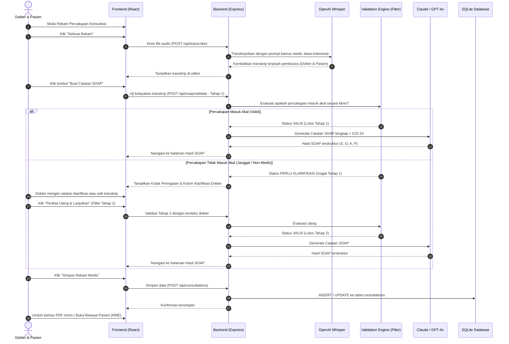

# DOKUMENTASI SISTEM LENGKAP: DOCTOR ASSISTANT MVP
> **Physician Note Taker Assistant & Electronic Medical Record (RME) System**  
> Sistem AI Pencatatan Rekam Medis Otomatis Dwibahasa (Indonesia & Jawa) dengan Filtering Kelayakan Klinis Dua Tahap.

---

## DAFTAR ISI
1. [Gambaran Umum & Tujuan Project](#1-gambaran-umum--tujuan-project)
2. [Arsitektur Teknologi](#2-arsitektur-teknologi)
3. [Alur Kerja Sistem (End-to-End Workflow)](#3-alur-kerja-sistem-end-to-end-workflow)
4. [Penjelasan Fitur Utama Berdasarkan Revisi Dosen](#4-penjelasan-fitur-utama-berdasarkan-revisi-dosen)
   - [A. Whisper Mix Bahasa Jawa & Prompt AI Lengkap](#a-whisper-mix-bahasa-jawa--prompt-ai-lengkap)
   - [B. Filtering Kelayakan Medis 2 Tahap (Plausibility Filter)](#b-filtering-kelayakan-medis-2-tahap-plausibility-filter)
   - [C. Rekam Medis Longitudinal Ala Rumah Sakit (Kasus Pasien Alfonso)](#c-rekam-medis-longitudinal-ala-rumah-sakit-kasus-pasien-alfonso)
5. [Struktur Folder & Bedah Kode per File](#5-struktur-folder--bedah-kode-per-file)
   - [Backend (Node.js + Express + SQLite)](#backend-nodejs--express--sqlite)
   - [Frontend (React 19 + Vite)](#frontend-react-19--vite)
6. [Skema Basis Data (Database Schema)](#6-skema-basis-data-database-schema)
7. [Panduan Menjalankan Project](#7-panduan-menjalankan-project)
8. [Panduan Simulasi & Menjawab Pertanyaan Ujian Dosen](#8-panduan-simulasi--menjawab-pertanyaan-ujian-dosen)

---

## 1. GAMBARAN UMUM & TUJUAN PROJECT

### Latar Belakang Masalah
Dalam praktik klinis sehari-hari di Indonesia (Puskesmas, Klinik, maupun Rumah Sakit), dokter menghabiskan **30% hingga 50% waktu konsultasi** hanya untuk mengetik dokumentasi rekam medis (SOAP: *Subjective, Objective, Assessment, Plan*). Hal ini mengurangi kontak mata dan empati terhadap pasien. 

Tantangan di Indonesia semakin kompleks karena:
1. **Bahasa Daerah / Dwibahasa**: Di berbagai daerah (khususnya Jawa Tengah, Jawa Timur, dan D.I. Yogyakarta), pasien sering menyampaikan keluhan dalam Bahasa Jawa (*nggliyeng, boyok linu, weteng mules, sumer-sumer, adhem panas*), yang jika didengar oleh speech-to-text standar sering salah ketik (*mishear*).
2. **Risiko Halusinasi AI / Data Sampah (*Garbage In, Garbage Out*)**: Jika pasien dan dokter berbicara di luar konteks medis (misal: mengobrol bola, belanja) atau rekaman audio terdistorsi noise, sistem AI biasa akan tetap memaksakan membuat diagnosis medis palsu (*hallucination*).

### Solusi Doctor Assistant
Aplikasi ini hadir sebagai **asisten dokumentasi medis cerdas** yang:
- Merekam audio percakapan dokter-pasien secara langsung.
- Mentranskripsikan audio dan memisahkan pembicara (*diarization*) dengan pemahaman dwibahasa Indonesia & Jawa.
- Melakukan **audit kelayakan medis secara otomatis di latar belakang (*2-Stage Plausibility Filtering*)** untuk memastikan percakapan masuk akal sebelum diproses.
- Menyusun catatan SOAP standar rumah sakit lengkap dengan perkiraan kode diagnosis **ICD-10**.
- Menyediakan rekam medis elektronik (RME) longitudinal untuk melihat riwayat pasien dari kunjungan pertama, kedua, dan seterusnya.

---

## 2. ARSITEKTUR TEKNOLOGI

```
+--------------------------------------------------------------------------+
|                        FRONTEND (React 19 + Vite)                        |
| - Halaman Beranda (Dashboard)                                            |
| - Halaman Konsultasi & Audio Recording (MediaRecorder API)               |
| - Halaman Hasil SOAP & Editor                                            |
| - Halaman Rekam Medis Elektronik (RME Longitudinal Puskesmas/RS)         |
| - jsPDF (Ekspor Berkas Resmi PDF)                                        |
+------------------------------------+-------------------------------------+
                                     |  HTTP REST API (JSON / FormData)
                                     v
+--------------------------------------------------------------------------+
|                     BACKEND (Node.js + Express.js)                       |
| - API Router & Multer Audio Upload (Max 25MB)                            |
| - SQLite Database (better-sqlite3)                                       |
+-------------------+----------------------------------+-------------------+
                    |                                  |
                    v                                  v
+-----------------------------------+  +-----------------------------------+
|      OPENAI AUDIO (WHISPER)       |  |     AI REASONING (CLAUDE / GPT)   |
| - Diarization (Dokter vs Pasien)  |  | - Validation Service (Filter 1&2) |
| - Clinical Javanese-Indo Prompt   |  | - Clinical SOAP Generator (ICD-10)|
+-----------------------------------+  +-----------------------------------+
```

---

## 3. ALUR KERJA SISTEM (END-TO-END WORKFLOW)



---

## 4. PENJELASAN FITUR UTAMA BERDASARKAN REVISI DOSEN

### A. Whisper Mix Bahasa Jawa & Prompt AI Lengkap
- **Masalah Asli**: Whisper standar sering menganggap bahasa Jawa sebagai kata bahasa Indonesia yang salah ketik (contoh: *"nggliyeng"* diubah jadi *"menggiling"* atau *"boyok linu"* diubah jadi *"bocah linu"*).
- **Solusi**: Di file `backend/src/services/transcribeService.js`, kami menyuntikkan parameter `CLINICAL_WHISPER_PROMPT`:
  ```javascript
  const CLINICAL_WHISPER_PROMPT =
    "Percakapan konsultasi medis klinis antara dokter dan pasien dalam Bahasa Indonesia bercampur Bahasa Jawa (Ngoko dan Krama). Kosa kata medis dan keluhan daerah: mumet, nggliyeng, ngelu, boyok linu, kemeng, weteng mules, sebah, sumer-sumer, athus-athus, adhem panas, gerah, watuk grok-grok, sesek, unjuk obat, nedha, tensi inggil, mboten saged sare, abuh, ndredeg. Transkripsikan dengan akurat kata-kata bahasa daerah dan medis tersebut.";
  ```
- **Sistem Prompt AI SOAP**:
  Di `backend/src/services/claudeService.js`, prompt klinis secara otomatis:
  1. Menerjemahkan keluhan Jawa ke terminologi medis formal (misal: *nggliyeng* &rarr; vertigo/pusing berputar, *boyok linu* &rarr; *low back pain*/myalgia).
  2. Menyertakan kutipan asli pasien dalam tanda petik pada bagian **Subjective** sebagai bukti legalitas anamnesis.
  3. Menyertakan perkiraan kode **ICD-10** resmi pada bagian **Assessment** (contoh: `[I10] Hipertensi Esensial`, `[R42] Vertigo / Dizziness`).

---

### B. Filtering Kelayakan Medis 2 Tahap (Plausibility Filter)
- **Tujuan Dosen**: Mencegah transkrip yang tidak masuk akal langsung diproses menjadi rekam medis. Jika tidak masuk akal, harus ada *flow* (alur koreksi), dan setelah dikoreksi harus ada *filtering lagi* (tahap 2).
- **Cara Kerja Sesuai Arahan Pengguna (*By System*)**:
  - Dokter tidak perlu terganggu dengan tulisan-tulisan teknis/skor yang rumit di layar.
  - Saat dokter menekan **"Buat Catatan SOAP"**, sistem menjalankan **Filter Tahap 1** di latar belakang.
  - **Kriteria Evaluasi**:
    1. Relevansi Medis (Apakah memuat gejala, keluhan fisik, atau tindakan pemeriksaan?).
    2. Koherensi Dialog (Apakah saling menyambung antara keluhan pasien dan respon dokter?).
    3. Deteksi Non-Medis (Mendeteksi obrolan belanja, makanan, lelucon, atau suara noise).
  - **Jika Tidak Masuk Akal**: Muncul kotak peringatan elegan:
    - Menjelaskan bahwa percakapan belum memuat keluhan medis yang jelas.
    - Dokter dapat memperbaiki teks transkrip atau menambahkan **Catatan / Klarifikasi Dokter**.
    - Tombol **"Periksa Ulang & Lanjutkan"** mengeksekusi **Filter Tahap 2**.
  - Hanya jika telah diverifikasi, SOAP Note resmi akan disusun.

---

### C. Rekam Medis Longitudinal Ala Rumah Sakit (Kasus Pasien Alfonso)

#### Mengapa Kunjungan Alfonso Sebelumnya Hanya Terdeteksi 1 Kali?
Setelah kami melakukan inspeksi langsung ke dalam basis data SQLite (`SELECT * FROM consultations`), ditemukan fakta berikut:
1. **Kunjungan 1 (ID 8, Tanggal 15-10-2026)**:
   - `patient_name`: "Alfonso"
   - `patient_id`: "001"
2. **Kunjungan 2 (ID 9, Tanggal 26-10-2026)**:
   - `patient_name`: "Alfonso"
   - `patient_id`: `""` *(kosong/empty string karena saat sesi kedua No. RM tidak diketik ulang)*.

Sebelumnya, query di model lama menggunakan:
```sql
WHERE patient_id IS NOT NULL AND patient_id != '' GROUP BY patient_id
```
Akibatnya: Kunjungan kedua Alfonso yang No. RM-nya kosong **tidak ikut terhitung dalam profil Alfonso**, melainkan terlempar ke daftar "Konsultasi Tanpa No. RM".

#### Solusi yang Diterapkan:
1. **Perbaikan Data**: Kami telah mengaitkan konsultasi ID 9 milik Alfonso ke No. RM `001`. Sekarang di sistem Alfonso **resmi terdeteksi 2x kunjungan**.
2. **Otomatisasi Backend (`consultationModel.js`)**:
   - Jika dokter mendaftarkan pasien dengan nama yang sudah pernah ada di database tetapi lupa mengisi No. RM, sistem **secara otomatis mencari dan mengaitkan No. RM pasien tersebut dari riwayat sebelumnya**.
   - Query `getPatients()` kini mengelompokkan data berdasarkan nama pasien secara terpadu (*case-insensitive*), sehingga kunjungan masa lalu tidak akan pernah terpecah lagi.
3. **Tampilan Rekam Medis Ala Rumah Sakit (SIMRS / Puskesmas)**:
   - Mengikuti referensi gambar dari pengguna (Pacitan SIMRS), ketika nama Alfonso diklik, sistem membuka **Tabel RME Longitudinal**:
     - **Header Biru Muda**: No RM (`001`), Nama (`ALFONSO`), Tanggal Lahir/Usia, Cara Bayar (`BPJS/Umum`), Poliklinik (`POLI UMUM`).
     - **Baris Kunjungan 1 (15-10-2026)**: Menampilkan keluhan sakit kepala depan, kurang tidur, riwayat keluarga hipertensi, tanda vital, asesmen, dan resep obat.
     - **Baris Kunjungan 2 (26-10-2026)**: Menampilkan keluhan sakit kepala belakang pasca lari, tensi, asesmen, dan resep obat kunjungan kedua.
     - Tombol **"Print Halaman Ini"** dan **"Print Semua Kunjungan"** untuk mencetak rekam medis resmi.

---

## 5. STRUKTUR FOLDER & BEDAH KODE PER FILE

```
doctor-assistant-mvp-v2/
├── backend/
│   ├── .env                             # Konfigurasi PORT & API Keys (OpenAI & Anthropic)
│   ├── package.json                     # Dependencies backend
│   ├── server.js                        # Entry point server Express (PORT 5000)
│   └── src/
│       ├── app.js                       # Inisialisasi Express, CORS, & routing API
│       ├── database/
│       │   ├── db.js                    # Koneksi SQLite database (doctor_assistant.sqlite)
│       │   └── doctor_assistant.sqlite  # File database lokal
│       ├── models/
│       │   └── consultationModel.js     # Query database: CRUD rekam medis & riwayat pasien
│       ├── controllers/
│       │   ├── consultationController.js # Handler HTTP endpoint konsultasi & pasien
│       │   ├── soapController.js         # Handler HTTP endpoint SOAP & validasi
│       │   └── transcribeController.js   # Handler upload file audio & Whisper
│       ├── routes/
│       │   ├── consultationRoutes.js     # Route /api/consultations
│       │   ├── soapRoutes.js             # Route /api/soap/generate & /api/soap/validate
│       │   └── transcribeRoutes.js       # Route /api/transcribe (Multer)
│       └── services/
│           ├── claudeService.js          # Generator SOAP (Prompt engineering klinis + ICD-10)
│           ├── validationService.js      # Mesin filtering kelayakan percakapan 2 tahap
│           └── transcribeService.js      # OpenAI Whisper API + Prompt kamus Bahasa Jawa
│
├── frontend/
│   ├── index.html                       # Shell HTML
│   ├── package.json                     # Dependencies frontend (React 19, Vite, jsPDF)
│   ├── vite.config.js                   # Konfigurasi Vite
│   └── src/
│       ├── main.jsx                     # Entry point React
│       ├── App.jsx                      # Router (Dashboard, Konsultasi, SOAPResult, History)
│       ├── index.css                    # Variabel CSS global, palet warna, tipografi
│       ├── components/
│       │   ├── Navbar.jsx               # Header navigasi (Beranda, Konsultasi, Riwayat)
│       │   └── Navbar.css               # Desain header kapsul
│       ├── pages/
│       │   ├── Dashboard.jsx            # Halaman beranda ringkas & profesional
│       │   ├── Dashboard.css            # Styling beranda
│       │   ├── Consultation.jsx         # Halaman perekaman suara & filter 2 tahap
│       │   ├── Consultation.css         # Styling halaman konsultasi
│       │   ├── SOAPResult.jsx           # Tampilan detail catatan SOAP & tombol aksi
│       │   ├── SOAPResult.css           # Styling hasil SOAP
│       │   ├── History.jsx              # Tampilan RME Longitudinal Rumah Sakit
│       │   └── History.css              # Styling RME ala Puskesmas/Rumah Sakit
│       └── services/
│           ├── api.js                   # Client fetch HTTP ke backend API
│           └── pdfService.js            # Generator dokumen PDF rekam medis resmi (jsPDF)
└── DOKUMENTASI_SISTEM.md                # File dokumentasi ini
```

---

## 6. SKEMA BASIS DATA (DATABASE SCHEMA)

Aplikasi menggunakan **SQLite** (`better-sqlite3`) yang ringan, cepat, tanpa perlu setup server database eksternal:

### Tabel `consultations`
| Nama Kolom | Tipe Data | Keterangan |
| :--- | :--- | :--- |
| `id` | `INTEGER PRIMARY KEY AUTOINCREMENT` | ID unik konsultasi |
| `patient_name` | `TEXT` | Nama lengkap pasien (misal: "Alfonso") |
| `patient_id` | `TEXT` | Nomor Rekam Medis (misal: "001") |
| `consultation_date` | `TEXT` | Tanggal periksa (format `YYYY-MM-DD`) |
| `transcript` | `TEXT` | Transkrip percakapan dokter dan pasien |
| `subjective` | `TEXT` | Catatan Subjektif (keluhan, riwayat penyakit, kutipan Jawa) |
| `objective` | `TEXT` | Catatan Objektif (tanda vital, status lokalis, lab) |
| `assessment` | `TEXT` | Catatan Asesmen (diagnosis kerja + kode ICD-10) |
| `plan` | `TEXT` | Catatan Rencana (obat, dosis, edukasi, rujukan) |
| `created_at` | `TEXT` | Timestamp penyimpanan (`CURRENT_TIMESTAMP`) |

---

## 7. PANDUAN MENJALANKAN PROJECT

### 1. Jalankan Backend
Buka terminal baru di folder `backend`:
```bash
cd backend
npm run dev
```
Backend akan aktif di: `http://localhost:5000`

### 2. Jalankan Frontend
Buka terminal baru di folder `frontend`:
```bash
cd frontend
npm run dev
```
Frontend akan aktif di: `http://localhost:5173`

---

## 8. PANDUAN SIMULASI & MENJAWAB PERTANYAAN UJIAN DOSEN

Jika dosen meminta Anda mendemonstrasikan sistem saat sidang atau presentasi, berikut langkah dan penjelasan terbaik:

### Skenario 1: Menunjukkan Dukungan Bahasa Jawa & Whisper
1. Buka menu **Konsultasi Baru**.
2. Masukkan nama pasien (misal: `Ny. Siti`) dan No. RM.
3. Klik tautan kecil: *"Gunakan contoh percakapan"* (atau rekam suara langsung dengan bahasa Jawa: *"Sirah kulo nggliyeng dok, weteng kulo mules, boyok linu"*).
4. Klik **"Buat Catatan SOAP"**.
5. **Poin Penjelasan ke Dosen**:
   > *"Sistem kami tidak sekadar speech-to-text biasa, Pak/Bu. Kami menyematkan kamus fonetik medis lokal pada prompt Whisper sehingga keluhan bahasa daerah seperti 'nggliyeng' tidak hilang, dan AI menerjemahkannya ke istilah klinis baku (vertigo) pada bagian Subjektif tanpa menghilangkan kutipan asli pasien."*

### Skenario 2: Menunjukkan Filtering Kelayakan Medis 2 Tahap
1. Masukkan percakapan ngawur/non-medis (misal klik *"Contoh percakapan non-medis"* tentang martabak dan sepak bola).
2. Klik **"Buat Catatan SOAP"**.
3. Sistem akan **menolak membuat SOAP** dan menampilkan kotak peringatan kuning: *"Percakapan Memerlukan Klarifikasi Klinis"*.
4. Dokter mengisi catatan klarifikasi di kolom yang disediakan (misal: *"Pasien mengeluh kelelahan fisik pasca olahraga"*).
5. Klik **"Periksa Ulang & Lanjutkan"** (ini mengeksekusi **Filter Tahap 2**).
6. Sistem memvalidasi ulang dan berhasil membuat catatan SOAP.
7. **Poin Penjelasan ke Dosen**:
   > *"Ini adalah implementasi filtering 2 tahap sesuai revisi. Sistem melakukan verifikasi kelayakan terlebih dahulu. Jika transkrip di luar konteks klinis, sistem menahan generasi rekam medis dan meminta klarifikasi dokter (flow koreksi), lalu memfilter ulang di tahap 2 sebelum catatan resmi disimpan."*

### Skenario 3: Menunjukkan Rekam Medis Longitudinal (Kasus Alfonso)
1. Buka menu **Riwayat Pasien**.
2. Tunjukkan baris pasien **Alfonso** yang kini memiliki keterangan **2x Kunjungan**.
3. Klik **"Buka Rekam Medis"**.
4. Tunjukkan tabel RME bergaya Rumah Sakit/Puskesmas:
   - Terlihat riwayat kunjungan pertama (15-10-2026) dan kunjungan kedua (26-10-2026).
   - Dokter dapat membandingkan keluhan kunjungan 1 dan kunjungan 2 secara berdampingan.
5. **Poin Penjelasan ke Dosen**:
   > *"Sistem kami telah mengadopsi standar RME longitudinal rumah sakit. Setiap pasien yang datang berulang kali akan tercatat riwayatnya secara kronologis, sehingga dokter pemeriksa dapat langsung mengevaluasi perkembangan penyakit dan terapi obat dari kunjungan sebelumnya."*

---
*Dokumen ini disusun untuk melengkapi seluruh kebutuhan teknis, pengujian, dan akademik project Doctor Assistant MVP v2.*

